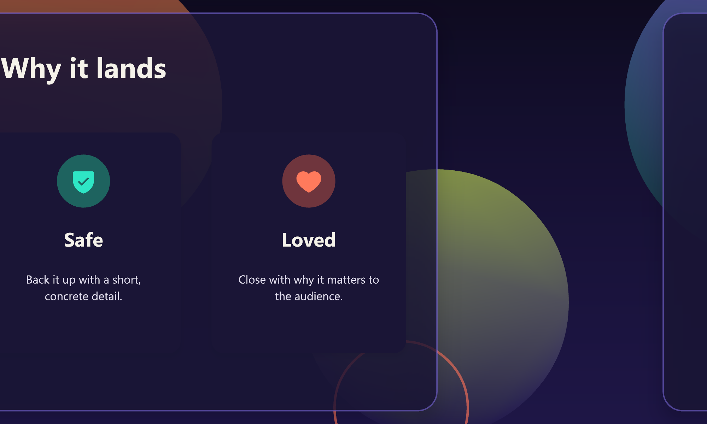
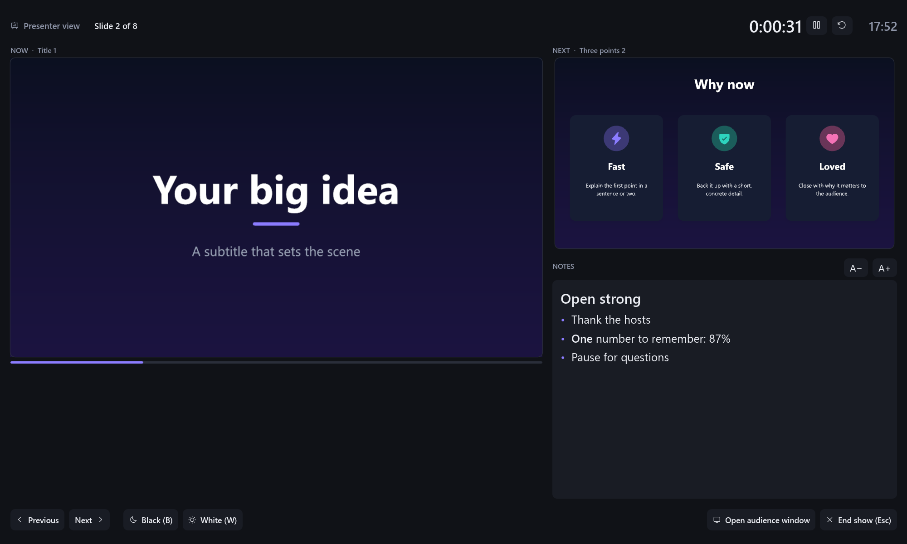
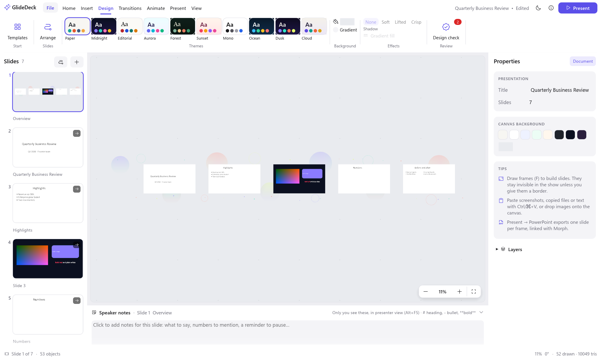
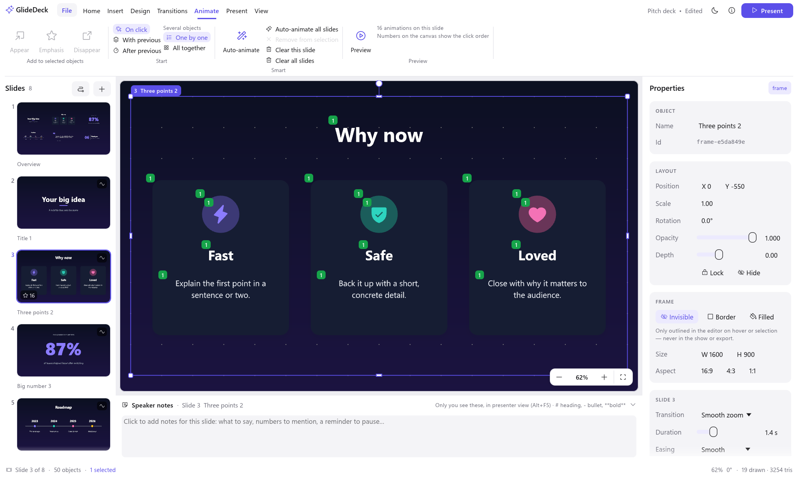

<p align="center">
  
</p>

<h1 align="center">GlideDeck</h1>

<p align="center">
  <b>Presentations that move.</b><br>
  Put your whole talk on one infinite canvas and glide, zoom and swoop between ideas.<br>
  Works with your PowerPoint files. Free, fast and private: it runs entirely on your computer.
</p>

<p align="center">
  <a href="https://github.com/nirlotan/GlideDeck/releases/latest/download/GlideDeck-x64.msi"></a>
  <a href="https://github.com/nirlotan/GlideDeck/releases/download/v0.1.5/GlideDeck-0.1.5.dmg"></a>
</p>


---

## Contents

- [Download and install](#download-and-install)
- [What you can do](#what-you-can-do)
- [Get started in two minutes](#get-started-in-two-minutes)
- [Works with PowerPoint](#works-with-powerpoint)
- [Feature tour](#feature-tour)
- [Let Claude or GitHub Copilot build your deck](#let-claude-or-github-copilot-build-your-deck)
- [Privacy](#privacy)
- [Questions](#questions)
- [For developers](#for-developers)

---

## Download and install

| Your computer | Download | How to install |
|---|---|---|
| **Windows 10 / 11** (64-bit) | **[⬇ GlideDeck-x64.msi](https://github.com/nirlotan/GlideDeck/releases/latest/download/GlideDeck-x64.msi)** (always the latest version) | Double-click the file and follow the installer. It adds GlideDeck to the Start menu. |
| **Mac with Apple Silicon** (M1 or newer) | **[⬇ GlideDeck-0.1.5.dmg](https://github.com/nirlotan/GlideDeck/releases/download/v0.1.5/GlideDeck-0.1.5.dmg)** | Open the file and drag GlideDeck into **Applications**. The app is signed and notarized by Apple. |
| Other versions | [All releases](https://github.com/nirlotan/GlideDeck/releases) | Every version, with release notes and SHA-256 checksums. |

- **Already installed?** Choose **ⓘ → Check for updates** (or **File → Check for updates**).
  GlideDeck downloads the new installer for you, and installing it upgrades your copy in place.
- **Windows says "Windows protected your PC"?** The installer isn't code-signed yet. Click
  **More info → Run anyway**.
- **Want to play videos in your slides?** Install FFmpeg once: `winget install Gyan.FFmpeg` on
  Windows, or `brew install ffmpeg` on a Mac.

## What you can do

- **Import a PowerPoint deck and make it move.** Open any `.pptx`. Your slides, text,
  pictures and speaker notes come along. One click arranges them into a carousel, a spiral,
  orbits or a tree.
- **Export back to PowerPoint or PDF.** Get a `.pptx` where every move is a native Morph
  transition, or a PDF to share.
- **Start from a template.** 18 complete stories with a theme and a path, from a pitch deck to
  a parallax **carousel**.
- **Bring slides to life.** Make text and pictures appear, take the spotlight and leave, with
  a click or automatically. **Auto-animate** does a whole slide at once.
- **Present like a pro.** Presenter view shows your speaker notes, the next slide and a timer
  on your screen while the audience sees only the show.
- **Let AI do the first draft.** Claude and GitHub Copilot can build a complete GlideDeck
  presentation for you, ready to edit.

| | |
|---|---|
|  **Carousel: slides glide past over drifting parallax layers** |  **Presenter view: your notes, the next slide, a timer** |
|  **A PowerPoint deck, imported and arranged as a carousel** |  **Animations, with the click order on the canvas** |

## Get started in two minutes

1. **Open GlideDeck** and press **F5**. The welcome canvas is itself a presentation, so you can
   see what's possible. Press → to move on and **Esc** to stop.
2. **Start your own.** Use **File → New from template** (try **Carousel**), or
   **File → Import PowerPoint…**.
3. **Edit.** Double-click any text to change it. Add slides with **Insert → Layouts**, or press
   **F** and drag to draw a new slide (a *frame*) anywhere on the canvas.
4. **Write your speaker notes** in the **Speaker notes** panel under the canvas.
5. **Make it move.**
   - **Transitions** sets how the camera flies into each slide.
   - **Animate → Auto-animate** builds a slide's content in.
   - **Design → Arrange** reshapes the whole path.
6. **Present** with **F5**. With a second screen or projector connected, presenter view starts
   automatically. On one screen, press **Alt+F5** to rehearse with your notes.
7. **Share.** Use **Present → PowerPoint** or **PDF**, or just send the `.glide.json` file.

| To… | Do this |
|---|---|
| Zoom / move around | Scroll or pinch · drag with Space held down (or the middle mouse button) |
| Rotate the view | Alt + scroll, or `[` `]` |
| Edit text | Double-click it, or select it and press Enter |
| Resize / rotate an object | Drag a corner handle · drag the round knob (Shift snaps to 15°) |
| Present | F5 from the start · Shift+F5 from the current slide · Alt+F5 presenter view |
| See every shortcut | F1 |

## Works with PowerPoint

**Bring your decks in.** Choose **File → Import PowerPoint…**, or drop or open a `.pptx`.

- Each slide becomes a frame on the canvas, in order.
- Text keeps its formatting.
- Shapes, pictures, slide backgrounds and master logos come along.
- Speaker notes appear in presenter view.

Then use **Design → Arrange** to turn the grid of slides into a story. Choose from a
**carousel** with a parallax backdrop, a spiral, orbits, a tree, a zoom tunnel and more.
(Tables, charts and SmartArt aren't converted yet; GlideDeck lists them for you.)

**Paste from PowerPoint.** Copy shapes in PowerPoint and paste them into GlideDeck. They
arrive as editable text, shapes and pictures (Windows).

**Send decks back out.**
- **Present → PowerPoint** writes one slide per stop on your path, linked with **Morph**, so
  PowerPoint itself animates the zooms, pans and turns. Icons stay editable vectors; videos are
  embedded.
- **Present → PDF** writes one page per slide, exactly as presented.

## Feature tour

### A canvas without edges
- Put anything anywhere, and zoom **a million times** deeper. Text, shapes and icons stay
  razor sharp at every size.
- Slides are **frames**: draw one around anything to make it a stop on your path. Frames are
  invisible in the show unless you give them a border, and moving a frame moves what's inside.
- The **Slides** list on the left works like PowerPoint's. You get thumbnails, drag to
  reorder, and right-click for more.

### Motion
- **Camera moves** between slides:
  - **Smooth zoom** pulls back for context, then dives in.
  - **Swoop** is a sideways arc with a roll.
  - **Spin** is a barrel roll.
  - **Punch** overshoots, then settles.
  - **Fade** dips through the background.
  - **Direct** and **Cut** are plain moves.
- **Animations inside a slide** (the **Animate** tab):
  - *appear* effects: fade, rise, focus, zoom, pop, drop, fly in, spin, typewriter, word by word and count up;
  - *emphasis*: spotlight, highlight marker, underline, color pop, pulse, glow and wiggle;
  - *disappear*: fade out, sink, zoom out, fly out and shrink.

  Numbers on the canvas show the click order, and **Preview** plays them in the editor.
- **Arrange slides** (Design → Arrange) reshapes the whole path for any number of slides.
  Choose a carousel, spiral, orbits, sunflower, ring, honeycomb, journey, wave, staircase,
  tree, zoom tunnel, snake or grid.
- **Parallax:** give any object a **Depth** (Properties → Layout). In the show, far objects
  drift slower than the slides and near ones faster.

### Design that looks good by default
- **18 templates**, each a complete story with a theme and a camera path:
  - **Business:** carousel, pitch deck, roadmap, showcase, branches.
  - **Storytelling:** journey, summit, spiral, deep dive.
  - **Ideas & maps:** big picture, hive, orbit, mood board.
  - **Teaching:** lecture, chapters, workshop, cycle.
- **Ten themes**, including the 2026 palettes **Dusk** (deep violet with aurora accents) and
  **Cloud** (warm white with teal and coral). Switching themes restyles text and colours while
  keeping the colours you picked by hand.
- **20 slide layouts**, such as title, agenda, three points, comparison, dashboard, team,
  timeline, process, Venn and hub & spokes.
- **1,500 vector icons**, soft shadows, gradients, image masks, and smart guides as you drag.
- **Design check** finds low-contrast or too-small text, empty slides and low-resolution
  images, with one-click fixes.

### Content
- **Rich text:** bold, italic, underline, strikethrough, colours and sizes, bullets and
  numbering. Right-to-left languages (Hebrew, Arabic) work too.
- **Pictures:** insert them, drag and drop, or paste screenshots and images from other apps.
- **SVG graphics:** shown as true vectors.
- **Video:** with sound, autoplay, loop and mute.

### Presenting
- **Fullscreen show** with keyboard and clicker support. Press **B** or **W** to black or white
  out the screen.
- **Presenter view:** the audience sees the show on the projector, and you see the live slide,
  the next slide, your notes, a timer and the clock.
  - On a single screen, presenter view shows everything in one window, so you can rehearse.
  - **Open audience window** adds a separate slides-only window when you need one, for example
    to share in a video call.
- **Speaker notes** live in the panel under the canvas. Use `# headings`, `- bullets` and
  `**bold**`.

### More screenshots

| | |
|---|---|
|  **Themes, slide strip and dark mode** |  **Start from a template** |
|  **Ready-made slide layouts** |  **1,500 vector icons** |
|  **Right-to-left text and numbering** |  **Design check with one-click fixes** |
|  **Fullscreen presenting** | |

## Let Claude or GitHub Copilot build your deck

GlideDeck comes with an **MCP server** and an **agent skill**. They let Claude (Claude Code,
Claude Desktop) and GitHub Copilot (VS Code and CLI) create presentations for you. The
assistant:

- picks a template, writes every slide and the speaker notes;
- shapes the path and adds animations;
- checks each slide visually;
- saves a normal GlideDeck file you can open and edit.

To set it up, run this once in the folder where you keep your presentations:

```bash
glidedeck agent-setup
```

Then ask, for example:

> Create a 7-slide GlideDeck presentation about our Q3 results in q3.glide.json, with
> speaker notes, and export a PowerPoint copy.

The server has 23 tools:
- **Find:** `catalog`, `search_icons`.
- **Create and read:** `create_presentation`, `import_pptx`, `get_presentation`.
- **Edit:** `add_slide`, `update_elements`, `add_text`, `add_image`, `set_theme`, `remove_slide`,
  `arrange_slides`, `edit_presentation`.
- **Bring it to life:** `animate`, `auto_animate`, `set_transitions`, `set_notes`,
  `clear_animations`.
- **Check and deliver:** `render_slide`, `export_pptx`, `export_pdf`, `save_as`,
  `open_in_editor`.

It runs on your computer and makes no network calls. Setup for each app and troubleshooting
are in the **[AI guide](docs/AI.md)**.

## Privacy

GlideDeck has no accounts, no cloud and no telemetry. Your presentation is one file on your
disk (`.glide.json`), with its pictures in an `assets/` folder next to it. The app goes online
only when you click **Check for updates**, and then only to GitHub.

## Questions

**Can I open my GlideDeck presentation on another computer?** Yes. Copy the `.glide.json` file
together with its `assets/` folder.

**Do my viewers need GlideDeck?** No. Present from your computer, or export to PowerPoint or PDF.

**Where did my notes go after importing a PowerPoint?** They come along. You'll find them in the
**Speaker notes** panel under the canvas and in presenter view.

**Something's wrong or missing?** [Open an issue](https://github.com/nirlotan/GlideDeck/issues).

---

## For developers

<details>
<summary><b>Build from source</b></summary>

You need Rust 1.88+ ([rustup.rs](https://rustup.rs)) plus a platform linker: the Visual Studio
C++ Build Tools on Windows, or `xcode-select --install` on macOS.

```bash
git clone https://github.com/nirlotan/GlideDeck.git
```

```bash
cd GlideDeck
```

```bash
cargo run --release -p glidedeck
```

See **[RUNNING.md](RUNNING.md)** for the full guide: platform notes, every shortcut, and the
complete CLI and JSON reference. Tests (core maths, exporter, renderer and end-to-end UI flows
driven through `egui_kittest` on a real GPU device):

```bash
cargo test --workspace
```

</details>

<details>
<summary><b>Command line and JSON operations</b></summary>

The same program is also a headless tool:

```bash
glidedeck new talk.glide.json --template carousel
```

```bash
glidedeck apply talk.glide.json examples/add-slide.ops.json
```

```bash
glidedeck render talk.glide.json --step 3 --out slide3.png
```

```bash
glidedeck import-pptx deck.pptx --out deck.glide.json
```

```bash
glidedeck arrange deck.glide.json --layout carousel
```

```bash
glidedeck export-pptx talk.glide.json --out talk.pptx
```

Operations are plain tagged JSON, applied **atomically** per batch:

```json
[
  {"op": "add_element", "element": {"id": "hello", "transform": {"x": 0, "y": 0},
    "kind": {"type": "text", "content": "Hello", "role": "title"}}},
  {"op": "add_element", "element": {"id": "f1",
    "kind": {"type": "frame", "width": 1600, "height": 900}}},
  {"op": "add_step", "frame": "f1", "transition": {"style": "smooth", "duration": 1.4}}
]
```

The document format (`"format": "glidedeck/1"`) is stable, pretty-printed JSON. Media lives in
`assets/`, named by content hash. Full reference: [RUNNING.md § 4](RUNNING.md#4-headless-cli-scripts-and-agents).

</details>

<details>
<summary><b>Windows MSI installer</b></summary>

Requirements: the Rust toolchain and the **WiX Toolset 3** binaries. Download
`wix314-binaries.zip` from the [WiX releases](https://github.com/wixtoolset/wix3/releases) and
unzip it anywhere; no installation is needed.

```bash
powershell -ExecutionPolicy Bypass -File packaging\windows\build-msi.ps1 -WixDir C:\tools\wix314
```

The script builds the release binary, which embeds the icon and version info, and writes
`dist\GlideDeck-<version>-x64.msi`. The installer:

- installs per machine into `Program Files\GlideDeck`;
- creates Start-menu and (optional) desktop shortcuts;
- adds the `glidedeck` CLI to `PATH`;
- ships the example deck;
- upgrades earlier versions in place (stable `UpgradeCode`, major-upgrade rules).

To trust it with SmartScreen, sign it with a code-signing certificate:

```bash
signtool sign /fd SHA256 /tr http://timestamp.digicert.com /td SHA256 /a dist\GlideDeck-0.1.6-x64.msi
```

The update check in the app looks for a `.msi` (Windows) or `.dmg` (macOS) asset on the latest
GitHub release, so attach installers to each release.

</details>

<details>
<summary><b>macOS DMG</b></summary>

Run these on a Mac with Rust and the Xcode Command Line Tools. Build for this Mac's
architecture, or as a universal binary:

```bash
packaging/macos/build-dmg.sh
```

```bash
UNIVERSAL=1 packaging/macos/build-dmg.sh
```

The script builds the release binary (with `UNIVERSAL=1`, both architectures joined with
`lipo`). It then assembles `dist/GlideDeck.app` from `packaging/macos/Info.plist`, generates the
`.icns` icon, signs the app and writes `dist/GlideDeck-<version>.dmg`.

To distribute, sign and notarize with an Apple Developer ID. First store notarization
credentials once:

```bash
xcrun notarytool store-credentials glidedeck-notary --apple-id you@example.com --team-id TEAMID
```

Then build, sign, notarize and staple in one go:

```bash
SIGN_IDENTITY="Developer ID Application: Your Name (TEAMID)" NOTARY_PROFILE=glidedeck-notary UNIVERSAL=1 packaging/macos/build-dmg.sh
```

Find your identity with `security find-identity -v -p codesigning`. Without signing, ad-hoc
signed apps run on the Mac that built them. On other Macs, right-click the app and choose
**Open** the first time.

</details>

<details>
<summary><b>Architecture</b></summary>

```
crates/
  glide-core     Document schema (serde JSON), f64 camera maths, transitions, builds,
                 themes, the atomic Op set. No GUI/GPU dependencies.
  glide-render   wgpu renderer: lyon tessellation, cosmic-text shaping and editing,
                 vector icons, SVG (usvg), mipmapped images, video (FFmpeg + cpal),
                 analytic shadows, offscreen MSAA targets, headless readback.
  glide-pptx     OpenXML writer: path → slides linked with Morph; vector icons,
                 native SVG, embedded video.
  glidedeck      The app: eframe/egui editor (ribbon, slide strip, inspector, notes,
                 galleries, design check), the show and presenter view, animations,
                 PowerPoint import, PDF export, the CLI and the MCP server.
```

Design decisions:

- **Tessellate once, transform forever.** Meshes live in element-local space on the GPU;
  moving and camera motion only update a per-instance affine.
- **Precision at depth.** Transforms are f64, and each element's matrix is composed relative
  to the camera before dropping to f32.
- **One renderer, many outputs.** The editor, thumbnails, galleries, the show, PDF and PNG
  export all come from the same offscreen renderer.
- **The show renders a scene.** Animations and parallax produce a per-frame copy of the
  document; the file itself never changes while presenting.
- **Non-destructive and diff-friendly.** Geometry and transforms are stored separately, files
  are pretty-printed JSON written atomically, and media is content-addressed.

</details>

## Roadmap

- Tables and charts from PowerPoint
- Audio clips, video trimming, and video export of the path
- Grouping, more shape types and connectors

## License

[MIT](LICENSE). Phosphor icons © Phosphor Icons, MIT
([assets](crates/glide-render/assets/phosphor/LICENSE.md)).
