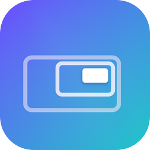
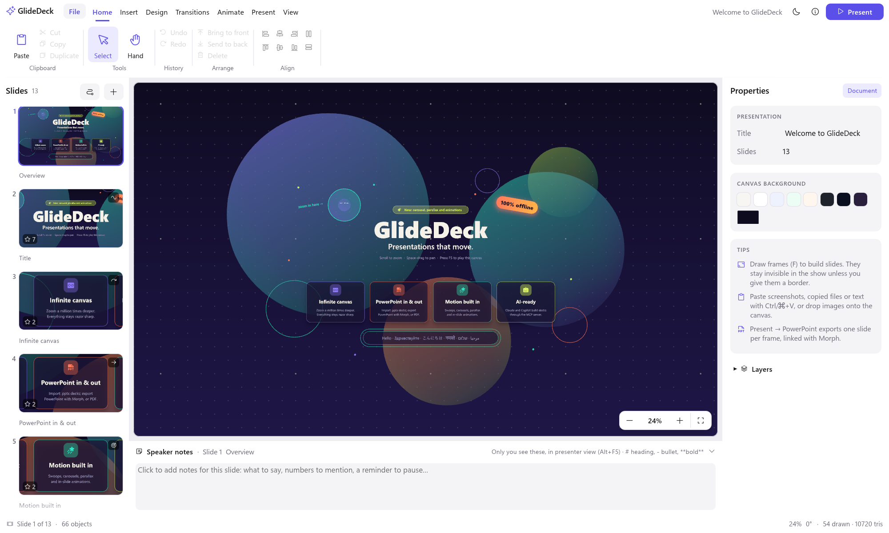
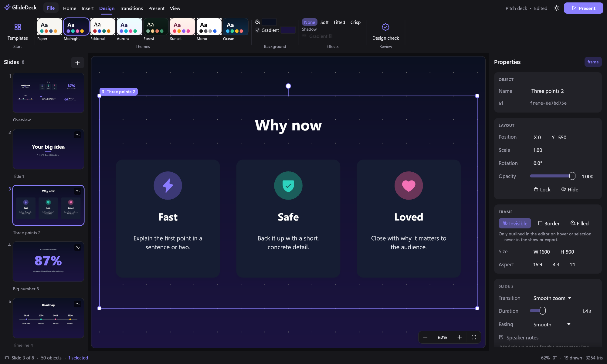
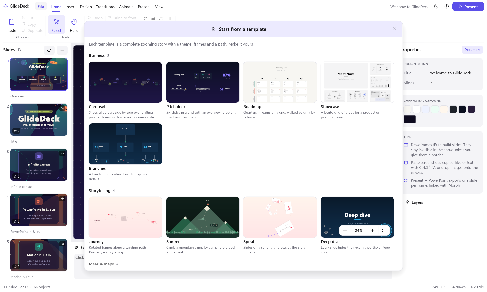
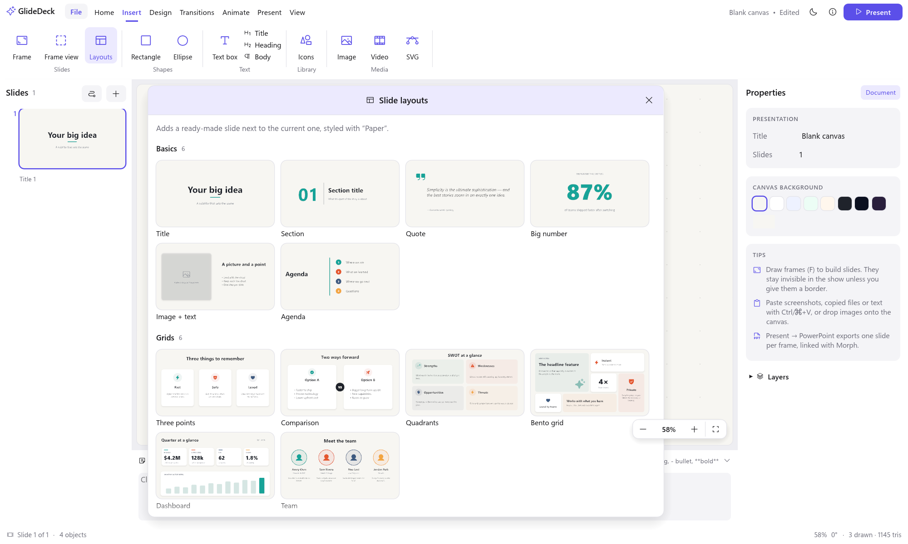
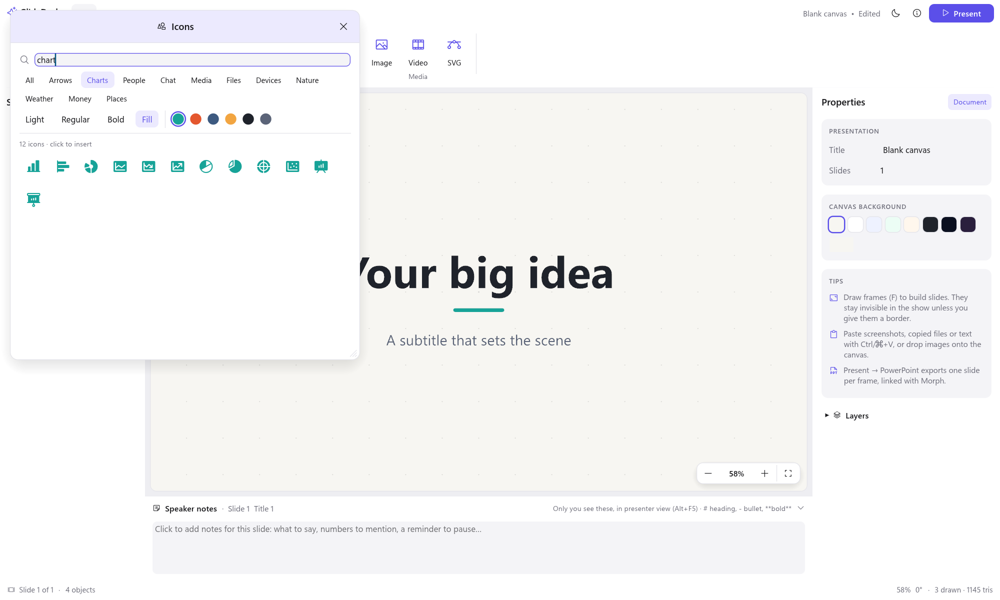
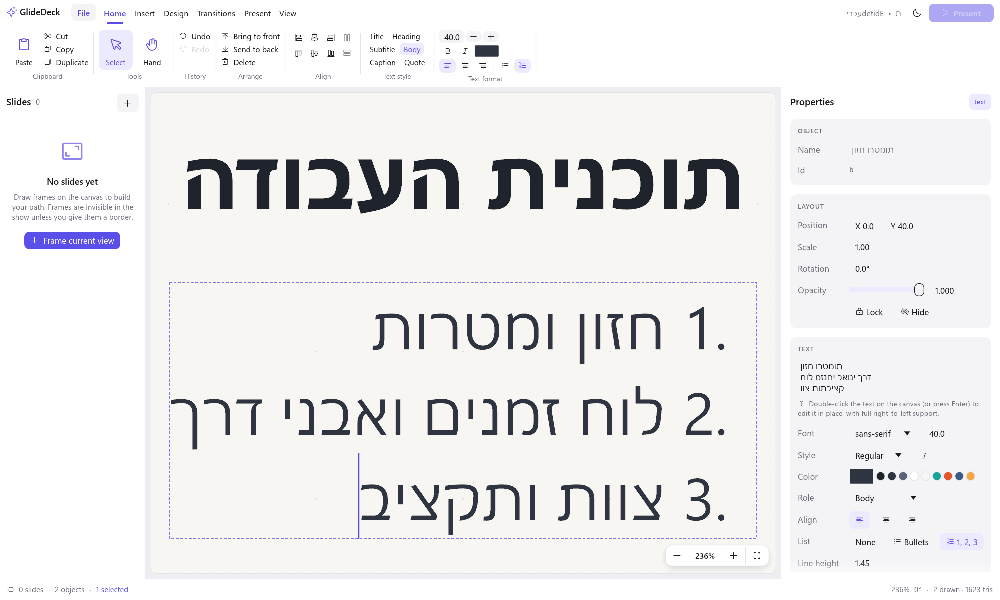
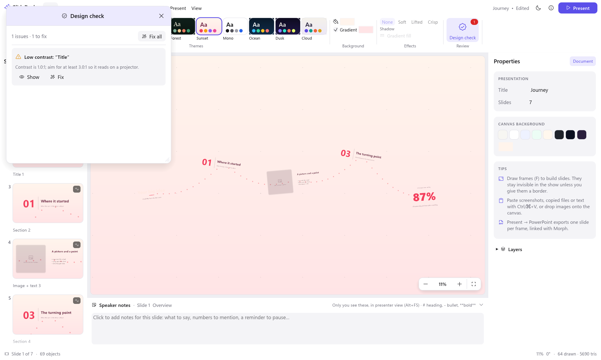
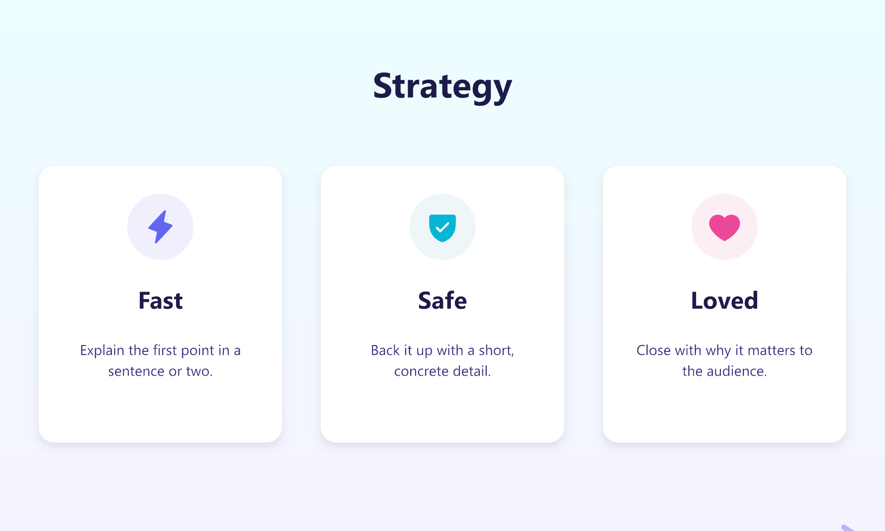

<p align="center">
  
</p>

<h1 align="center">GlideDeck</h1>

<p align="center">
  <b>Zooming presentations, built natively.</b><br>
  An infinite canvas you glide across: local-first, GPU-accelerated, written in Rust.
</p>

<p align="center">
  
  
  
  
</p>

<p align="center">
  <a href="https://github.com/nirlotan/GlideDeck/releases/latest/download/GlideDeck-x64.msi"></a>
  <a href="https://github.com/nirlotan/GlideDeck/releases/download/v0.1.5/GlideDeck-0.1.5.dmg"></a>
  <br>
  <sub>Windows 10/11 x64 · includes the MCP server for Claude and GitHub Copilot · <a href="https://github.com/nirlotan/GlideDeck/releases">all releases</a></sub>
</p>



---

## Contents

- [The concept](#the-concept)
- [Features](#features)
- [Screenshots](#screenshots)
- [Installation](#installation)
- [Quick start](#quick-start)
- [Use with Claude and GitHub Copilot](#use-with-claude-and-github-copilot)
- [Automation: CLI and JSON ops](#automation-cli-and-json-ops)
- [Packaging](#packaging)
  - [Windows MSI installer](#windows-msi-installer)
  - [Creating a macOS DMG](#creating-a-macos-dmg)
- [Architecture](#architecture)
- [Privacy](#privacy)
- [Roadmap](#roadmap)
- [License](#license)

---

## The concept

Slides are boxes in a row. Ideas aren't. **GlideDeck** puts your whole talk on a single,
unbounded canvas and moves a camera across it. It zooms out to show how things connect,
dives into a detail, and rotates into the next thought. Your story becomes a **path
through space** instead of a stack of pages.

GlideDeck follows the **ArtCraft philosophy**:

- **Native, not web.** Pure Rust with a GPU renderer (wgpu: DirectX 12, Metal, Vulkan). No
  Electron, no web views, no JavaScript.
- **Local-first and private.** No accounts, cloud, sync or telemetry. Your deck is one
  human-readable JSON file, with media in an `assets/` folder next to it.
- **Single-player.** No collaboration features. It's a focused tool for one author.
- **Agent-ready.** A built-in MCP server and an agent skill let Claude and GitHub
  Copilot build decks for you. Every edit is also a JSON operation, so scripts can
  build, restyle, render and export decks from the command line.

## Features

### An infinite, precise canvas
- Unbounded 2D space with smooth pan, zoom and rotation, with all maths in 64-bit floats,
  so content stays exact even **a million times** deeper.
- Text, shapes, icons and SVGs are **tessellated vectors**. They stay razor sharp at every
  zoom, with no blurry bitmaps.
- Familiar controls: scroll or pinch to zoom, Space-drag to pan, Alt-scroll to rotate,
  Shift/Ctrl-click to multi-select, and marquee selection.

### Slides are frames
- Draw **frames** anywhere. Each frame on the path becomes a slide in a PowerPoint-style
  **slide strip** with live thumbnails, drag-to-reorder and right-click actions.
- Frames are **invisible by default**. They group objects logically and guide the
  camera, show only a faint outline on hover in the editor, and never appear in the show
  unless you give them a border or fill.
- Moving a frame carries its contents. **Frame them** wraps any selection into a new slide.
- **Arrange slides** (Design → Arrange) moves every slide into a new layout and path:
  - **Layouts:** spiral, orbits, sunflower, ring, honeycomb, journey, wave, staircase,
    tree, zoom tunnel, snake or grid;
  - **Options:** slides can turn along the path, with a dotted trail and an overview
    at the start and end;
  - **Any number of slides:** every layout is computed, not hand-placed;
  - **Main use:** turning an imported PowerPoint grid into a story.

### Cinematic motion
- **Smooth zoom** transitions follow the van Wijk–Nuij optimal path: the camera pulls back
  just enough for context, then dives in. Six more camera moves give each slide its own
  entrance: **Swoop** (a sideways arc with a roll), **Spin** (a barrel roll), **Punch**
  (overshoot and settle), **Fade** (a dip through the background), **Direct** and **Cut**,
  with per-slide duration and easing.
- **In-slide animations** (the **Animate** tab): objects can *appear* (Fade, Rise, Focus,
  Zoom, Pop, Drop, Fly in, Spin, Typewriter, Word by word, Count up), be *emphasised*
  (Spotlight, Highlight marker, Underline, Color pop, Pulse, Glow, Wiggle) and *disappear*
  (Fade out, Sink, Zoom out, Fly out, Shrink), on a click, with the previous one or after
  it. **Auto-animate** gives a slide a tasteful entrance cascade in one click. Numbered
  badges show the click order on the canvas, and **Preview** plays it in the editor.
- **Fullscreen presenting** with keyboard and clicker navigation, an auto-hiding control
  bar, free zooming mid-talk, and videos that start automatically when you arrive at
  their slide.
- **Presenter view on a second display**: the show goes fullscreen on the projector while
  your screen shows the live slide, the next slide, your speaker notes, a timer and the
  clock, plus black/white screen (B/W). It turns on automatically with two displays; with
  one, Alt+F5 opens the audience view in its own window.

### Design that looks good by default
- **17 templates** in four groups, each a complete story with a theme and a path:
  - **Business**: pitch deck, roadmap, showcase, branches.
  - **Storytelling**: journey, summit, spiral, deep dive.
  - **Ideas & maps**: big picture, hive, orbit, mood board.
  - **Teaching**: lecture, chapters, workshop, cycle.

  Many use structures only an infinite canvas allows: planets on orbits, camps up a
  mountain, a honeycomb, a spiral, portholes nested five levels deep, and a wheel the camera
  turns around.
- **Eight themes**, colour and font pairings with optional gradient backgrounds. Switching
  theme restyles text by its role, and colours taken from the old theme follow to the new
  one; colours you picked by hand stay put.
- **20 slide layouts**, each dropped in next to the current slide:
  - **Basics**: title, section, quote, big number, image + text, agenda.
  - **Grids**: three points, comparison, quadrants, bento grid, dashboard, team.
  - **Diagrams**: hub & spokes, cycle, Venn, pyramid.
  - **Flows**: timeline, process, staircase, winding road.
- **Icon library**: about 1,500 Phosphor icons in four weights, searchable, recolourable,
  and exported to PowerPoint as editable vectors.
- **Text styles** (Title, Heading, Subtitle, Body, Caption, Quote), **bullets and
  numbering** with hanging indents, GPU **soft shadows**, **gradient fills**, and
  **rounded or circular image masks**.
- **Smart guides** snap edges and centres while you drag, alongside **align and
  distribute**.
- **Design check** reviews the deck for low-contrast text (WCAG), text too small to read
  on its slide, empty slides, missing or low-resolution images, and font sprawl, with
  one-click fixes.

### Rich content
- **Rich text**: bold, italic, underline, strikethrough, colour and size for any word or
  phrase, from a floating format bar while you edit on the canvas or with the usual
  shortcuts (Ctrl/⌘+B, I, U). Formatting exports to PowerPoint and survives pasting from
  it. Drag a text box's **side handles** to change its wrap width without scaling the text.
- **Images**: insert them, drag and drop, or paste screenshots, browser images, copied
  files and text straight from other apps.
- **Paste from PowerPoint** (Windows): copied shapes arrive as editable text boxes, shapes
  and pictures, keeping their layout, fonts and colours. Ctrl/⌘+Shift+V pastes plain text
  from any app.
- **SVG** rendered as true vectors, including gradients, strokes and text.
- **Video** with sound, a framed player, autoplay, loop and mute (uses a local FFmpeg).
- **In-place text editing** with full **right-to-left** support (Hebrew, Arabic), bidi,
  IME and word motion, built on the same engine that renders the text.
- **Resize and rotate handles**: corner handles scale uniformly, and a knob rotates
  (Shift snaps to 15°).

### Export
- **PowerPoint (.pptx)**: one slide per step. Every object keeps its identity (`!!<id>`)
  and slides are linked with **Morph**, so PowerPoint itself animates the zooms, pans and
  rotations. Icons export as vector shapes, SVGs natively, and videos embedded.
- **PDF**: one page per slide, in show order, rendered exactly as presented.
- **PNG** of any view at 2×. Headless rendering of any slide is available from the CLI.

### Import
- **PowerPoint (.pptx)**: File → Import PowerPoint (or open or drop a `.pptx`).
  - **Each slide becomes a frame**, laid out in a grid and in order on the path, ready
    to turn into a zooming story.
  - **Content comes along**: text with its formatting, rectangles, ellipses and
    pictures, slide backgrounds, logos and lines from the slide master, and speaker
    notes.
  - **Placeholder styles carry over**: titles and bullets take the positions, sizes and
    bullets they inherit from the layout and master.
  - **Not converted yet**: tables, charts and SmartArt are listed as skipped.
- **Open recent**: File → Open recent lists the last 10 documents you opened, saved or
  imported.

## Screenshots

| | |
|---|---|
|  **Themes, slide strip and dark mode** |  **Start from a template** |
|  **Pre-designed slide layouts** |  **1,500 vector icons** |
|  **In-place editing with right-to-left text and numbering** |  **Design check with one-click fixes** |
|  **Fullscreen presenting** | |

<sub>Screenshots are produced by the automated UI suite (`readme_screenshots` in
`crates/glidedeck/src/ui_tests.rs`), which drives the real app on the GPU.</sub>

## Installation

### Windows: installer

1. **[Download the latest installer (GlideDeck-x64.msi)](https://github.com/nirlotan/GlideDeck/releases/latest/download/GlideDeck-x64.msi)**.
   Versioned installers and SHA-256 checksums are on the
   [Releases page](https://github.com/nirlotan/GlideDeck/releases). You can also
   [build it yourself](#windows-msi-installer).
2. Run it. GlideDeck installs to `Program Files\GlideDeck`, adds a Start-menu entry and a
   desktop shortcut (optional), and puts the `glidedeck` CLI on your `PATH`.
3. *(Optional, for video)* install FFmpeg:

```bash
winget install Gyan.FFmpeg
```

The installer isn't code-signed yet, so Windows SmartScreen may warn: choose
**More info → Run anyway**. Uninstall from **Settings → Apps**.

To let Claude or GitHub Copilot build presentations, run `glidedeck agent-setup` next
(see [Use with Claude and GitHub Copilot](#use-with-claude-and-github-copilot)).

### macOS

**[Download the latest macOS installer for Apple Silicon (GlideDeck-0.1.5.dmg)](https://github.com/nirlotan/GlideDeck/releases/download/v0.1.5/GlideDeck-0.1.5.dmg)**
and drag GlideDeck to Applications. The app and DMG are Developer ID signed, and
the DMG is notarized by Apple with a stapled notarization ticket. You can also
[build a DMG for Intel or Apple Silicon](#creating-a-macos-dmg) or run from source as below. For video,
install FFmpeg:

```bash
brew install ffmpeg
```

### From source (Windows and macOS)

You need Rust 1.88+ ([rustup.rs](https://rustup.rs)) plus a platform linker: the Visual
Studio C++ Build Tools on Windows, or `xcode-select --install` on macOS.

```bash
git clone https://github.com/nirlotan/GlideDeck.git
```

```bash
cd GlideDeck
```

```bash
cargo run --release -p glidedeck
```

See **[RUNNING.md](RUNNING.md)** for the full guide: prerequisites, platform notes,
every shortcut, and the complete CLI and JSON reference.

## Quick start

1. Launch GlideDeck. The welcome canvas is itself a presentation, so press **F5**.
2. Choose **File → New from template**, or start blank and pick a theme on the **Design** tab.
3. Press **F** and drag on the canvas to draw a frame, or use **Insert → Layouts** to add
   a ready-made slide.
4. Add text (**T**), shapes (**R**, **O**), icons (**Ctrl/⌘+Shift+K**), images, SVGs and
   video, or simply paste and drop.
5. Set transitions on the **Transitions** tab, bring slides to life on the **Animate** tab
   (try **Auto-animate**), and run **Design check**.
6. **Present** (F5), or **Present → PowerPoint** to hand off a Morph-animated deck.

| Action | Input |
|---|---|
| Zoom / pan / rotate | Scroll or pinch · Space-drag or middle-drag · Alt-scroll, `[` `]` |
| Tools | `V` select · `H` hand · `F` frame · `R` rect · `O` ellipse · `T` text |
| Edit text in place | Double-click, or Enter / F2 |
| Resize / rotate | Corner handles · round knob (Shift snaps to 15°) |
| Snap off while dragging | Hold Alt |
| Present | F5 (from start) · Shift+F5 (from current slide) |
| Everything else | F1 shows the full shortcut sheet |

## Use with Claude and GitHub Copilot

GlideDeck includes an **MCP server** (`glidedeck mcp`) and an **agent skill**, so Claude
Code, Claude Desktop, and GitHub Copilot (VS Code and CLI) can create presentations for
you. The assistant picks a template, writes each slide, renders every slide to check it,
and saves a regular GlideDeck project (`.glide.json`) that you can open and keep editing,
or export to PowerPoint.

To set it up, run this in the folder where you want your presentations:

```bash
glidedeck agent-setup
```

This installs the skill (`.claude/skills` and `.github/skills`) and registers the server
for Claude Code and Copilot CLI (`.mcp.json`) and for VS Code (`.vscode/mcp.json`). In
VS Code, switch Copilot Chat to **Agent** mode and the GlideDeck tools appear. Then ask:

> Create a 7-slide GlideDeck presentation about our Q3 results in q3.glide.json, check
> every slide, and export a PowerPoint copy.

The server has 22 tools:
- **Discover:** `catalog`, `search_icons`.
- **Create and read:** `create_presentation`, `import_pptx`, `get_presentation`.
- **Edit:** `add_slide`, `update_elements`, `add_text`, `add_image`, `set_theme`,
  `remove_slide`, `arrange_slides`, `edit_presentation`.
- **Bring it to life:** `animate`, `auto_animate`, `set_transitions`, `clear_animations`.
- **Check and deliver:** `render_slide` (returns the PNG), `export_pptx`, `export_pdf`,
  `save_as`, `open_in_editor`.

The assistant is told to make every deck stand out: shape the path with `arrange_slides`,
vary the camera moves, auto-animate each slide and add a spotlight or highlight on the key
moments. It runs locally over stdio and makes no network calls.
**Full guide** for each client (Claude Desktop, user-wide setup, troubleshooting):
[docs/AI.md](docs/AI.md).

## Automation: CLI and JSON ops

The same binary is also a headless tool:

```bash
glidedeck new talk.glide.json --template pitch-deck
```

```bash
glidedeck apply talk.glide.json examples/add-slide.ops.json
```

```bash
glidedeck render talk.glide.json --step 3 --out slide3.png
```

```bash
glidedeck export-pptx talk.glide.json --out talk.pptx
glidedeck export-pdf talk.glide.json --out talk.pdf
glidedeck import-pptx deck.pptx --out deck.glide.json
glidedeck arrange deck.glide.json --layout spiral
```

Operations are plain tagged JSON and are applied **atomically** per batch:

```json
[
  {"op": "add_element", "element": {"id": "hello", "transform": {"x": 0, "y": 0},
    "kind": {"type": "text", "content": "Hello", "role": "title"}}},
  {"op": "add_element", "element": {"id": "f1",
    "kind": {"type": "frame", "width": 1600, "height": 900}}},
  {"op": "add_step", "frame": "f1", "transition": {"style": "smooth", "duration": 1.4}}
]
```

The document format (`"format": "glidedeck/1"`) is stable, pretty-printed JSON that stores
only layout, coordinates and text. Media lives in `assets/`, named by content hash and
referenced by relative path. Full reference: [RUNNING.md § 4](RUNNING.md#4-headless-cli-scripts-and-agents).

## Packaging

### Windows MSI installer

Requirements: the Rust toolchain and the **WiX Toolset 3** binaries. Download
`wix314-binaries.zip` from the [WiX releases](https://github.com/wixtoolset/wix3/releases)
and unzip it anywhere; no installation is needed.

```bash
powershell -ExecutionPolicy Bypass -File packaging\windows\build-msi.ps1 -WixDir C:\tools\wix314
```

The script builds the release binary, which embeds the icon and version info, then writes
`dist\GlideDeck-<version>-x64.msi`. The installer:

- installs per machine into `Program Files\GlideDeck`;
- creates Start-menu and (optional) desktop shortcuts;
- adds the CLI to `PATH`;
- ships the example deck;
- supports upgrades in place, through a stable `UpgradeCode` with major-upgrade rules.

Edit `packaging/windows/glidedeck.wxs` to change what it installs.

To publish it, sign the MSI with your code-signing certificate so SmartScreen trusts it:

```bash
signtool sign /fd SHA256 /tr http://timestamp.digicert.com /td SHA256 /a dist\GlideDeck-0.1.5-x64.msi
```

### Creating a macOS DMG

Run these steps on a Mac with Rust and the Xcode Command Line Tools installed.

**1. Build the app bundle and DMG**, either for this Mac's architecture or as a
universal binary for Apple Silicon and Intel:

```bash
packaging/macos/build-dmg.sh
```

```bash
UNIVERSAL=1 packaging/macos/build-dmg.sh
```

The script:
1. builds the release binary (or, with `UNIVERSAL=1`, both architectures joined with `lipo`);
2. assembles `dist/GlideDeck.app`, filling in `Info.plist` from
   `packaging/macos/Info.plist`;
3. generates `GlideDeck.icns` from `assets/icon/` with `iconutil`;
4. ad-hoc signs the app;
5. creates `dist/GlideDeck-<version>.dmg`, with the usual drag-to-*Applications* shortcut.

**2. Install locally.** Open the DMG and drag **GlideDeck** to **Applications**. Ad-hoc
signed apps run on the Mac that built them. On other Macs, right-click the app, choose
**Open** and confirm the first time, or clear the quarantine flag:

```bash
xattr -dr com.apple.quarantine /Applications/GlideDeck.app
```

**3. Distribute (optional): sign and notarize** with an Apple Developer ID.

First, find your signing identity:

```bash
security find-identity -v -p codesigning
```

Then store notarization credentials once:

```bash
xcrun notarytool store-credentials glidedeck-notary --apple-id you@example.com --team-id TEAMID
```

Finally, sign, notarize and staple in one go:

```bash
SIGN_IDENTITY="Developer ID Application: Your Name (TEAMID)" NOTARY_PROFILE=glidedeck-notary UNIVERSAL=1 packaging/macos/build-dmg.sh
```

With `SIGN_IDENTITY` set, the script signs with the hardened runtime and a secure
timestamp. With `NOTARY_PROFILE` set, it also submits the DMG with `notarytool --wait` and
staples the ticket, so the DMG opens without Gatekeeper warnings on any Mac.

**Doing it by hand.** A `.app` is just a folder:

```
GlideDeck.app/Contents/
  Info.plist              bundle id, version, icon name
  MacOS/GlideDeck         the release binary
  Resources/GlideDeck.icns
```

`hdiutil create -volname GlideDeck -srcfolder <folder> -format UDZO GlideDeck.dmg` turns a
folder holding the app and an `Applications` symlink into a compressed disk image.

## Architecture

```
crates/
  glide-core     Document schema (serde JSON), f64 camera maths, transitions, themes,
                 the atomic Op set. No GUI/GPU dependencies.
  glide-render   wgpu renderer: lyon tessellation, cosmic-text shaping and editing,
                 vector icons, SVG (usvg), mipmapped images, video (FFmpeg + cpal),
                 analytic shadows, offscreen MSAA targets, headless readback.
  glide-pptx     OpenXML writer: path → slides linked with Morph; vector icons,
                 native SVG, embedded video.
  glidedeck      The app: eframe/egui editor (ribbon, slide strip, inspector,
                 galleries, design check) + the CLI.
```

Key design decisions:

- **Tessellate once, transform forever.** Meshes live in element-local space on the GPU.
  Moving, rotating and camera motion only update a per-instance affine. Curves are
  re-tessellated only when on-screen scale crosses a power of two.
- **Precision at depth.** Transforms are f64, and each element's matrix is composed
  relative to the camera before dropping to f32.
- **One renderer, many outputs.** The editor, slide thumbnails, galleries, the show,
  PNG export, and the icon itself all come from the same offscreen renderer.
- **Text you can trust.** One cosmic-text pipeline shapes, renders and *edits* text, so
  carets, bidi and line breaks are identical everywhere.
- **Non-destructive and diff-friendly.** Geometry and transforms are stored separately,
  never baked. Files are pretty-printed JSON written atomically, and media is
  content-addressed.

Tests cover the core maths, the exporter, the renderer, and end-to-end UI flows driven
through `egui_kittest` on a real GPU device:

```bash
cargo test --workspace
```

## Privacy

GlideDeck never opens a network connection. It reads fonts installed on your system,
bundles its icons, and spawns your local FFmpeg only to play video. There are no
accounts, no telemetry and no update pings.

## Roadmap

- Audio-only clips, video trimming, and video/PDF export of the path
- Grouping, more shape types and connectors

## License

[MIT](LICENSE). Phosphor icons © Phosphor Icons, MIT
([assets](crates/glide-render/assets/phosphor/LICENSE.md)).
