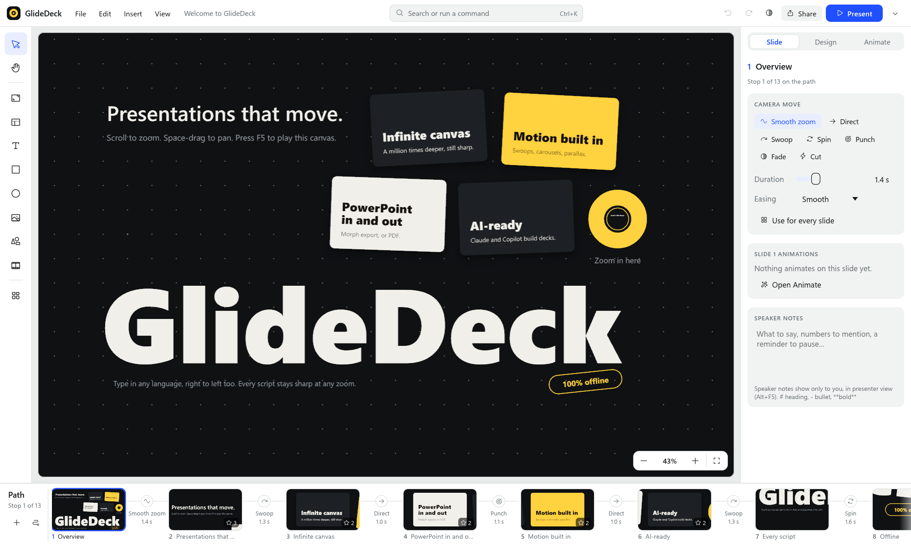
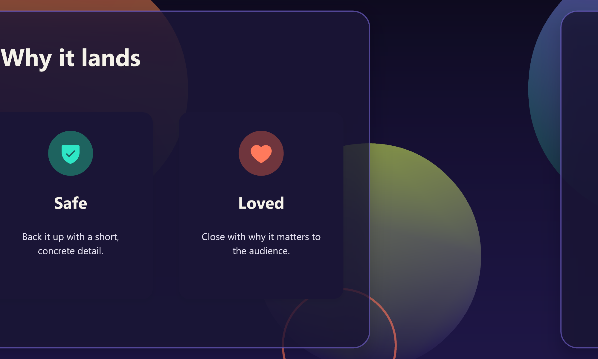

# GlideDeck outreach: where to list it, and drafts

Prepared 2026-10-22. GlideDeck was 10 days old with 0 stars at the time, so several
lists with popularity thresholds were skipped for now (see the end).

## Status (checked 2026-10-23)

| Where | Link | Status | Action needed |
|---|---|---|---|
| open-source-mac-os-apps | https://github.com/serhii-londar/open-source-mac-os-apps/pull/1744 | Open, no review yet | None, wait |
| awesome-mac | https://github.com/jaywcjlove/awesome-mac/pull/3747 | Open, license check passed | None, wait |
| awesome-mcp-servers | https://github.com/punkpeye/awesome-mcp-servers/pull/17252 | Open; Glama badge added and maintainer notified (2026-10-23) | Wait for merge; the `missing-glama` label should clear once Glama's checks pass |
| winget-pkgs | https://github.com/microsoft/winget-pkgs/pull/458762 | Open; CLA signed ✓; all validation passed except `Validation-Executable-Error` (post-install launch check) | Commented with `glidedeck.exe --version` (2026-10-23); waiting for a winget administrator |
| Awesome-presentation-tools | https://github.com/runablehq/Awesome-presentation-tools/pull/12 | Open, no activity | None (maintainers inactive) |
| egui Show and tell | https://github.com/emilk/egui/discussions/8759 | 1 upvote, no comments | None |
| Glama MCP registry | submitted 2026-10-23 via glama.ai/mcp/servers | Claimed by nirlotan; build test passed (13m, all 23 tools introspected); badge reads "rated A" | Click **Make Release** on Admin → Dockerfile (the form wouldn't open in the built-in browser) |
| GitHub Sponsors | https://github.com/sponsors/nirlotan | Live; no tiers visible yet | Optional: add tiers, e.g. a $9 one-time tier |
| Section C sites | not submitted | Need your logins | Post when ready |

## A. Pull requests (can be submitted from the nirlotan GitHub account)

### 1. serhii-londar/open-source-mac-os-apps (51k ★): macOS, open source only
Rules: one PR per app; edit `applications.json`, not the README; no popularity threshold.
Entry (category `productivity`):

```json
{
    "short_description": "Zooming presentations on an infinite canvas, with PowerPoint import and export.",
    "categories": ["productivity"],
    "repo_url": "https://github.com/nirlotan/GlideDeck",
    "title": "GlideDeck",
    "icon_url": "https://raw.githubusercontent.com/nirlotan/GlideDeck/main/assets/icon/glidedeck-256.png",
    "screenshots": [
        "https://raw.githubusercontent.com/nirlotan/GlideDeck/main/docs/screenshots/editor.png",
        "https://raw.githubusercontent.com/nirlotan/GlideDeck/main/docs/screenshots/carousel.png",
        "https://raw.githubusercontent.com/nirlotan/GlideDeck/main/docs/screenshots/presenter.png"
    ],
    "official_site": "https://github.com/nirlotan/GlideDeck",
    "languages": ["rust"]
}
```

### 2. jaywcjlove/awesome-mac (117k ★): "Office" section
Rules: alphabetical, one sentence, and the same entry in README.md, README-zh.md,
README-ja.md and README-ko.md. AI-assisted PRs are explicitly welcome.

- EN: `* [GlideDeck](https://github.com/nirlotan/GlideDeck) - Zooming presentations on an infinite canvas, with PowerPoint import and export. [![Open-Source Software][OSS Icon]](https://github.com/nirlotan/GlideDeck) ![Freeware][Freeware Icon] ![Native App][Native Icon]`
- ZH: `* [GlideDeck](https://github.com/nirlotan/GlideDeck) - 在无限画布上缩放演示的演示文稿工具，支持导入和导出 PowerPoint。 …icons…`
- JA: `* [GlideDeck](https://github.com/nirlotan/GlideDeck) - 無限キャンバス上でズームするプレゼンテーションツール。PowerPoint の読み込みと書き出しに対応。 …icons…`
- KO: `* [GlideDeck](https://github.com/nirlotan/GlideDeck) - 무한 캔버스에서 확대하며 발표하는 프레젠테이션 도구. PowerPoint 가져오기와 내보내기 지원. …icons…`

### 3. punkpeye/awesome-mcp-servers (97k ★): "Workplace & Productivity"
Rules: alphabetical by `owner/repo`, one line, legend emojis (🦀 Rust, 🏠 local, 🍎 🪟).

`- [nirlotan/GlideDeck](https://github.com/nirlotan/GlideDeck) 🦀 🏠 🍎 🪟 - Build zooming presentations: create decks from templates and layouts, import PowerPoint, arrange slides into paths, add animations and speaker notes, render slides to PNG, and export PPTX (with Morph) or PDF, saved as an editable GlideDeck project.`

Their CONTRIBUTING says agent-made PRs may add `🤖🤖🤖` to the title to be fast-tracked;
using it would also disclose that an AI prepared the PR.

### 4. microsoft/winget-pkgs: `winget install NirLotan.GlideDeck`
No popularity requirement. Manifests (validated with `winget validate`) are in
`scratchpad/submissions/winget/manifests/n/NirLotan/GlideDeck/0.1.6/`. Each new release
needs a version PR. `wingetcreate update NirLotan.GlideDeck -u <msi url> -v <version> --submit`
automates that.

### 5. runablehq/Awesome-presentation-tools (33 ★): "Open Source" section
Small, and the maintainers seem inactive: 8 PRs open, last push Nov 2025. Low effort, low impact.

`- [GlideDeck](https://github.com/nirlotan/GlideDeck) - Native, open-source zooming presentations on an infinite canvas (a Prezi alternative), with PowerPoint and PDF import/export. Windows and macOS.`

## B. Forum post that can be made from the GitHub account

### 6. emilk/egui → Discussions → "Show and tell" (active: several posts a week)

**Title:** GlideDeck: a zooming (Prezi-style) presentation app built with egui 0.36 + wgpu

**Body:**

> I've been building **GlideDeck**, a native zooming-presentation app: your whole talk sits on one
> infinite canvas and the camera glides between "frames". It's open source (MIT), for Windows and macOS.
>
> 
>
> How it uses egui:
> - **The whole editor UI** is egui 0.36 (eframe + wgpu): a PowerPoint-style ribbon, slide strip with live
>   thumbnails, inspector, galleries and a notes panel.
> - **The canvas** is a custom wgpu renderer (lyon tessellation, cosmic-text) drawing into an offscreen
>   target that egui shows as a texture. The same renderer feeds thumbnails, PDF export and the show.
> - **Presenter view** uses `show_viewport_immediate` for the audience window, with the console in the root viewport.
> - **Tests** drive the real app through `egui_kittest` on a GPU, including the README screenshots.
>
> 
>
> It also imports/exports PowerPoint (with Morph), has in-slide animations, and an MCP server so
> Claude/Copilot can build decks. Repo: https://github.com/nirlotan/GlideDeck. Feedback very welcome!

## C. Websites and forums you'll need to submit to yourself (they need your login)

| Where | What to do |
|---|---|
| **AlternativeTo** (alternativeto.net) | Add GlideDeck as an app, then mark it an alternative to Prezi, PowerPoint, Keynote, Pitch and Sozi. Platforms: Windows, macOS. License: Free, Open Source. |
| **mcpservers.org/submit** (feeds wong2/awesome-mcp-servers, 4k ★, which takes no PRs) | Name: GlideDeck. URL: repo. Description: same as #3. |
| **0PandaDEV/awesome-windows** (3k ★, "Office Suites") | The repo **forbids AI-generated PRs**. If you want it there, open the "Add Application" issue yourself. Suggested line: `* [GlideDeck](https://github.com/nirlotan/GlideDeck) - Zooming presentations on an infinite canvas, with PowerPoint import and export. [![Open-Source Software][oss]](https://github.com/nirlotan/GlideDeck)` |
| **Reddit r/rust** | Post title: "GlideDeck: a native Prezi-style presentation app in Rust (egui + wgpu), open source". Use the egui post body. |
| **Reddit r/macapps**, **r/opensource**, **r/software** | "I made a free, open-source zooming presentation app (imports/exports PowerPoint)". Keep it short, add a GIF, and answer comments. Check each subreddit's self-promotion rules first. |
| **Hacker News, Show HN** | "Show HN: GlideDeck – Open-source Prezi-style presentations, native in Rust". The URL is the repo. Post on a weekday morning (US time) and be around to answer. |
| **users.rust-lang.org** → Announcements | Same text as the egui post. |
| **opensourcealternative.to** | Submit via its form as an alternative to Prezi / PowerPoint. |

## D. Skipped for now (re-check when the repo is more popular)

| List | Why |
|---|---|
| rust-unofficial/awesome-rust | Requires 50+ stars (or 2,000 crates.io downloads). |
| Homebrew cask | Notability rule (stars, forks or watchers); a cask also needs the DMG on GitHub releases. |
| ScoopInstaller/Extras | Expects reasonably well-known apps. |
| vonnieda/awesome-egui | Archived. |
| appcypher/awesome-mcp-servers | Archived. |
| btw-so/open-source-alternatives | No activity since 2024. |
| aspose-slides/Awesome-Presentations, slideshow-s9/awesome-slideshows, Toxblh/Awesome-Windows-Apps | Inactive since 2018–2021. |
| Official MCP Registry | Needs a published package (npm, PyPI, OCI or an MCP bundle); doable later. |
